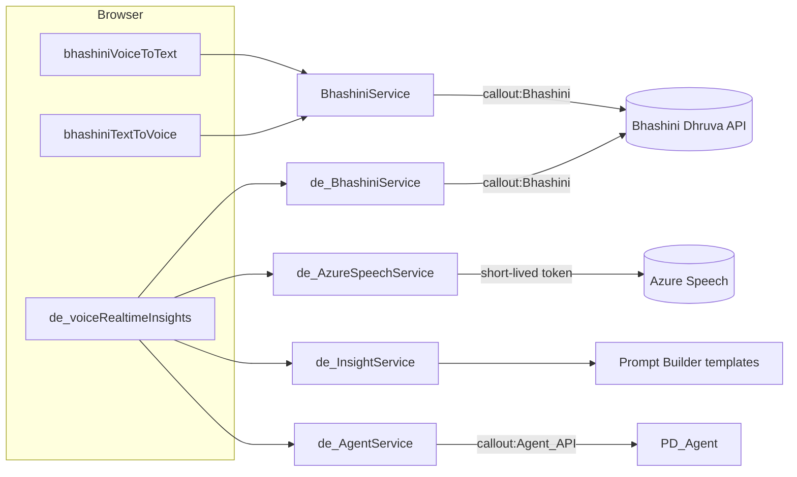

# Bhasha Bridge

Indic-language voice for Salesforce: speech-to-text, text-to-speech and translation in English, Hindi, Bangla, Gujarati, Marathi, Tamil and Telugu, powered by the Government of India [Bhashini](https://bhashini.gov.in) (Dhruva) API, plus a real-time call-transcription cockpit with live AI insights.

## What it does

**Core package (`force-app`)**
- `bhashiniVoiceToText` records microphone audio in the browser, sends it to Apex, and returns the transcript. One component, one `language` property (`en`, `hi`, `bn`, `gu`, `mr`, `ta`, `te`). It works on App, Home and Record pages and as a Flow screen component.
- `bhashiniTextToVoice` turns text into speech (Hindi, Bangla, Gujarati, Marathi, Tamil, Telugu). Apex stores the generated WAV as a File and the component plays it.
- `BhashiniService` is the single server-side client for Bhashini ASR, TTS and translation. Every call goes through the `Bhashini` Named Credential, so the API key never reaches the browser.
- `BhashiniOpenCasesSummary` is an invocable action (Flow / Agentforce). It summarises a contact's open Cases in the requested Indian language so the result can be read aloud with `bhashiniTextToVoice`.

**Real-time package (`realtime-insights`)**
- `de_voiceRealtimeInsights` is a live call cockpit. Pick a language and an engine (Bhashini chunked ASR, Salesforce Speech Foundations streaming, or Azure Speech streaming). It shows the transcript with an English translation, live insights (summary, action items, sentiment, topics, coaching tips) from a Prompt Builder template, and a question-coverage checklist from `PD_Agent`.
- `de_voiceStreamPlayer` and the `de_BhashiniStreamPage` Visualforce page stream microphone audio to Azure Speech Translation and play translated speech back.
- `de_contact360Card` is a compact contact card for the person on the call.
- `de_InsightService`, `de_TranscriptAnalysisAction`, `de_AgentService` and `PD_Agent` cover insights, question generation and transcript-vs-checklist analysis through the Agentforce Agent API.
- `heroku-translator/` is a standalone Node/Express demo of the same idea as a web app: any Indian language to English, with TTS.
- `docs/indian-asr-alternatives.md` compares Indian-language ASR options.

## Architecture



## Components

| Component | Purpose |
|---|---|
| `BhashiniService` | Parameterised Bhashini client (ASR / TTS / translation) via Named Credential |
| `BhashiniOpenCasesSummary` | Invocable action: open-case summary in a chosen Indian language |
| `BhashiniServiceTest` | Unit tests with `HttpCalloutMock` |
| `bhashiniVoiceToText` / `bhashiniTextToVoice` | Language-parameterised LWCs |
| `Bhashini` (Named Credential), `Bhashini_EC` (External Credential), `Bhashini_Access` (Permission Set) | Secret-free credential templates |
| `de_voiceRealtimeInsights`, `de_voiceStreamPlayer`, `de_contact360Card` | Real-time call UI |
| `de_BhashiniService`, `de_AzureSpeechService`, `de_InsightService`, `de_AgentService`, `de_TranscriptAnalysisAction` | Real-time Apex services |
| `PD_Agent`, `PD_Questions_Prompt`, `DE_Realtime_Voice_Insights`, `Speech_to_Text_QA_Prompt_ASA` | Agentforce agent and prompt templates |
| `de_Voice_Config__mdt` | Config for Azure and Speech Foundations (no Bhashini key) |
| `Agent_API` (Named Credential), `Agent_API_EC`, `Voice_Insights_Access` | Credential templates and permissions for the real-time package |

## Prerequisites
- Salesforce org with Lightning Experience, Prompt Builder and (for the real-time package) Agentforce.
- A Bhashini API key. Register at [bhashini.gov.in](https://bhashini.gov.in) for Dhruva inference access.
- Optional: an Azure Speech resource (Azure engine), and a Heroku or Node 20 host for `heroku-translator/`.
- The real-time package's prompt templates and `de_contact360Card` expect Contact custom fields such as `Occupation__c`. Create them or adjust the templates.
- Salesforce CLI (`sf`).

## Setup and deploy

```bash
sf project deploy start --source-dir force-app --target-org <alias>
sf project deploy start --source-dir realtime-insights --target-org <alias>   # optional
sf org assign permset --name Bhashini_Access --target-org <alias>
sf org assign permset --name Voice_Insights_Access --target-org <alias>        # optional
```

`force-app` must deploy first because the real-time package reuses the `Bhashini` Named Credential.

Heroku demo:

```bash
cd heroku-translator
cp .env.example .env   # fill in the values
npm install && npm start
```

## Configuration
1. **Bhashini key (required).** After deploying, go to Setup > Named Credentials > External Credentials > `Bhashini_EC`. Open the `Bhashini_Principal` principal and add an authentication parameter named `ApiKey` with your key as its value. The `Bhashini` Named Credential sends it as the `Authorization` header. Nothing secret is stored in source.
2. **Azure Speech (real-time package).** Edit `de_Voice_Config__mdt.Default`. Set `Azure_Key__c` (committed as `REPLACE_ME`) and `Azure_Region__c`. Apex exchanges the key for a ~10 minute token, so the browser never sees the key. Add a Remote Site Setting for `https://<region>.api.cognitive.microsoft.com`.
3. **Speech Foundations streaming (optional).** Set `ASF_Endpoint__c` and update the `ASF_Einstein_WSS` CSP Trusted Site to your endpoint host. This engine passes the user's session Id to the browser as its token, so use it only if that fits your security model.
4. **Agentforce Agent API.** Create an External Client App with the OAuth client-credentials flow. Configure `Agent_API_EC` with your My Domain token URL and the app's consumer key and secret. Set the `PD_Agent_Id` Custom Label to your deployed agent's Id, and set `default_agent_user` in `PD_Agent.agent` to your agent user.
5. **Heroku app.** Copy `heroku-translator/.env.example` and fill it in.

## Notes
- Text-to-speech for Telugu keeps the original `indo_aryan` model id. The Bhashini Dravidian model may suit it better. Change it in the `LANGUAGES` map in `BhashiniService`.
- Add screenshots to `docs/screenshots/`.

## License
MIT. See [LICENSE](LICENSE).
